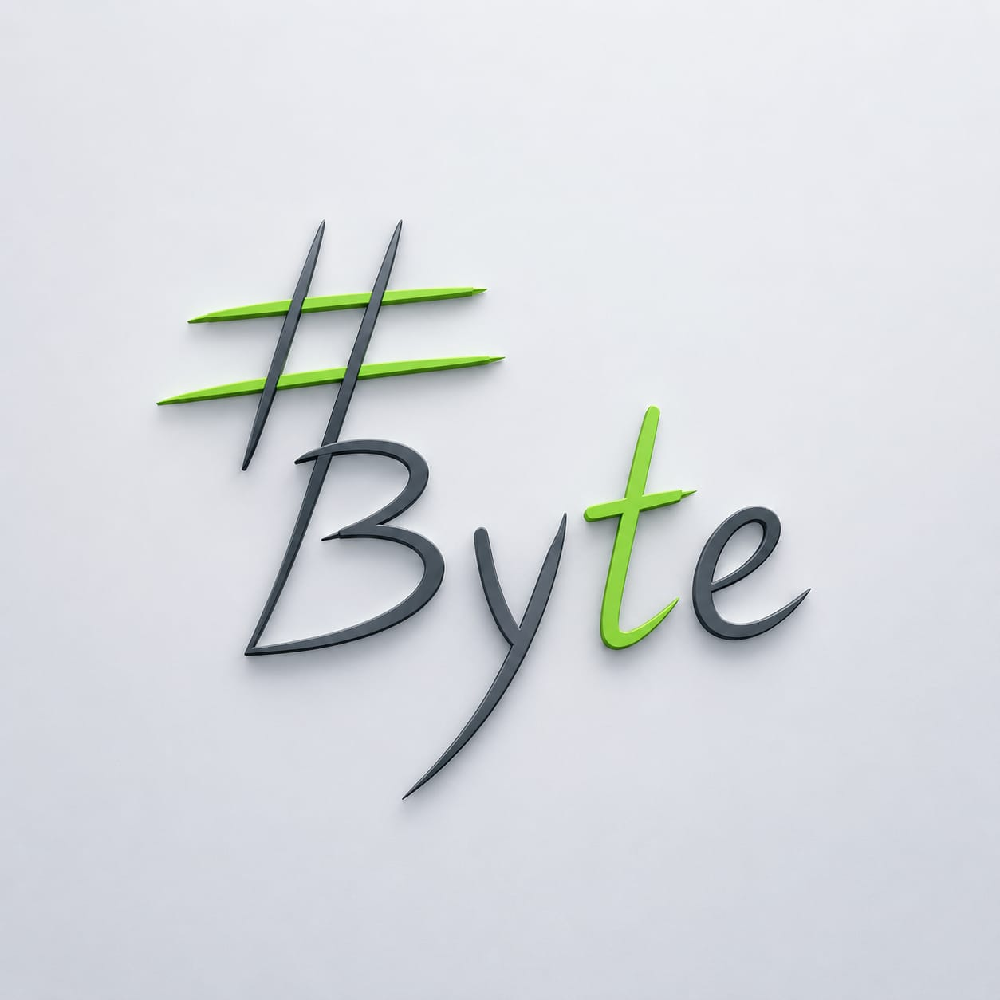
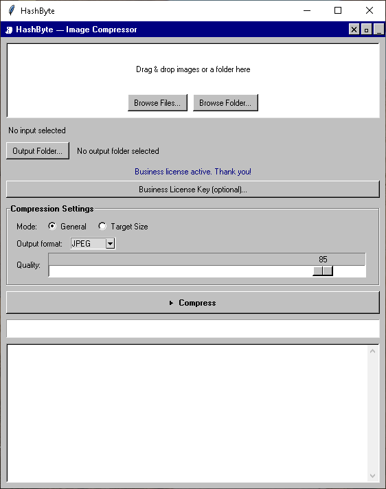
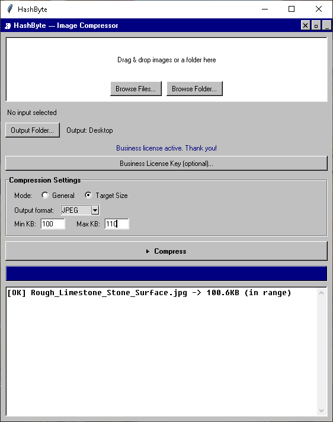

# HashByte

Fast batch image compressor for Windows with a Win98-style interface.
Compress JPEG, PNG, and WEBP files, or target an exact file size in KB.

## Download

Get the latest installer from
[Releases](https://github.com/hanook-solve/HashByte/releases/latest):
`HashByte-Setup-v0.2.0.exe`

Windows may show a SmartScreen warning because the app is not code-signed
yet. Click **More info > Run anyway**.

  

<h1 align="center">HashByte</h1>

  Fast batch image compressor for Windows with a Win98-style interface. 
  Compress JPEG, PNG and WEBP, or target an exact file size in KB.

  <a href="https://github.com/hanook-solve/HashByte/releases/latest"><b>⬇ Download for Windows</b></a>

## Screenshots

**Preview**

**Target size compression**

## Features

- Batch compression with drag and drop
- JPEG, PNG and WEBP support
- Quality mode (default) and target-size-in-KB mode
- Built-in auto-update

## Download

Get the latest installer from [Releases](https://github.com/hanook-solve/HashByte/releases/latest): `HashByte-Setup-v0.2.0.exe`

Windows may show a SmartScreen warning because the app is not code-signed yet. Click **More info > Run anyway**.

## License

Free for personal, educational, and non-profit use.
Businesses need a Business License: see [LICENSE](LICENSE) or contact
<hanookbai234@gmail.com>.

